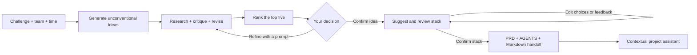
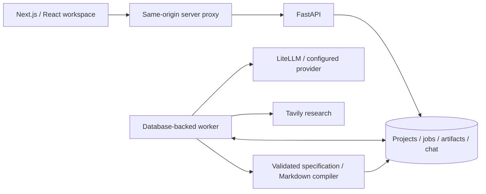

<div align="center">

# exHacker

### Find the idea. Challenge it. Leave with a plan you can build.

An AI product studio for hackathon teams — from a rough challenge to researched ideas, an approved stack, and an implementation handoff.

[](LICENSE)
[](frontend/package.json)
[](frontend/package.json)
[](backend/pyproject.toml)
[](backend/app/main.py)

[Try it with Docker](#try-it-with-docker) · [The workflow](#from-what-if-to-lets-build) · [Architecture](docs/ARCHITECTURE.md) · [Verification](docs/VERIFICATION.md) · [BYOK proposal](docs/BYOK.md)


</div>

The first hours of a hackathon often disappear into the same questions. *What should we build? Does it already exist? Can this team finish it?* By the time the idea feels solid, the clock has moved.

exHacker gives that uncertainty a working process. It starts with the people, their skills, and their deadline. It develops different directions, researches similar work, exposes the critique, and helps the team choose deliberately. Once the idea and stack are approved, it produces detailed Markdown that both humans and coding agents can work from. A project-aware assistant stays available for the build.

**Status:** active development. The application has reproducible local and Docker verification, including PostgreSQL and recovery scenarios. Live-provider quality, public hosting, load validation, and an [upstream Python dependency advisory constraint](docs/VERIFICATION.md#remaining-python-advisory-constraint) remain release gates. User-provided AI keys are an [assessed proposal](docs/BYOK.md), not a shipped feature. There is no hosted demo URL to advertise yet.

## From “what if?” to “let’s build”



| Step | What the team gets |
| --- | --- |
| **Brief the studio** | Required idea/theme, available hours, and teammate skills/proficiency. Optional judging criteria, rules, budget, platform, and technology constraints. |
| **Explore five directions** | Competitor/similar-project sources, critique, revisions, risks, assumptions, effort estimates, eight explained scores, and a server-calculated overall score. |
| **Make the idea yours** | Compare candidates, refine one with your own prompt, repeat research and scoring, then explicitly confirm a direction. |
| **Agree on the stack** | Technology purpose, alternatives, components, data flow, and compatibility risks. Edit suggestions or request substitutions before approving. |
| **Get the handoff** | Detailed requirements, acceptance criteria, contracts, task ownership/dependencies, test plans, and project-specific instructions for coding agents. |
| **Keep building** | Persistent chat with the confirmed plan, all documents, research, team, hackathon context, and conversation history. Pitch help is available when asked. |

Scores are advisory estimates. Search results cannot prove uniqueness, and no score guarantees a winning entry. The UI shows rationales and evidence rather than presenting model judgment as a fact.

### An implementation handoff, entirely in Markdown


*Actual application screenshots. The workspace image uses explicitly labeled offline fixtures; it is not evidence of live AI research or model quality.*

Preview rendered Markdown or its source, copy a document, download individual files, or export the saved package as a ZIP:

| Files | Purpose |
| --- | --- |
| `PRD.md` | Product requirements, user journeys, behavior, acceptance criteria, edge cases, and success measures. |
| `AGENTS.md` | Project-specific instructions, confirmed technologies, constraints, and working rules for coding agents. |
| `TECH_STACK.md`, `ARCHITECTURE.md` | Technical choices, responsibilities, and data flow. |
| `DATABASE.md`, `API.md` | Entities, validation, relationships, and request/response or native query/mutation contracts. |
| `SETUP.md`, `IMPLEMENTATION_PLAN.md` | Setup requirements, named teammate assignments, effort, and dependencies. |
| `RESEARCH.md`, `README.md` | Retrieved evidence, limitations, and the project's own introduction. |

Files come from one confirmed snapshot. Reading or downloading them does not regenerate them. Changing an upstream decision invalidates affected approvals/documents while preserving earlier snapshots in History.

## Try it with Docker

Install Docker with Compose v2, then run from a fresh checkout:

```sh
git clone https://github.com/Muneer320/exHacker.git
cd exHacker
docker compose -p exhacker-verify -f compose.verify.yml up --build --wait
```

Open **[localhost:3200](http://localhost:3200)**. No API key or `.env` file is needed for this deliberately offline evaluation. It runs the real frontend, API, PostgreSQL, migrations, background jobs, exports, and persistence. Generated ideas/documents are fixtures, research is absent, and the demonstration assistant is labeled. Natural-language stack revisions require live AI; manual edits work offline.

For a first walkthrough, enter a 48-hour mentoring challenge, add a React builder and a Python builder, compare the five directions, refine one, confirm it, change a technology choice, and generate the handoff. Reload a page to inspect persistence; return to the assistant after the documents are ready.

Stop the evaluation without deleting its database:

```sh
docker compose -p exhacker-verify -f compose.verify.yml down
```

### Run with live AI and research

Copy `.env.example` to `.env` in the repository root (`cp .env.example .env` on macOS/Linux, `Copy-Item .env.example .env` in PowerShell). Configure:

```dotenv
AI_MODEL=openai/gpt-4o-mini
AI_API_KEY=your-provider-api-key
TAVILY_API_KEY=your-search-api-key
STUDIO_DEMO_MODE=false
```

The model above is the configurable code default, not a promise of current account access or a model recommendation. Use a suitable provider-qualified text model and set input/output pricing to its actual rates. [Configuration](docs/CONFIGURATION.md) explains aliases, budgets, context/output limits, and model compatibility.

```sh
docker compose up --build --wait
```

Open **[localhost:3000](http://localhost:3000)**. This separate development stack uses a persistent SQLite volume. Missing or invalid providers produce visible errors and preserve saved work; no sample success is substituted. Provider credentials are currently configured by the operator. AI BYOK does not exist in the UI yet.

### Develop without Docker

Use Python 3.12 (supported minimum 3.11), [uv](https://docs.astral.sh/uv/), and Node.js 22+. After configuring the root `.env`, start two terminals:

```sh
# Terminal 1
cd backend
uv sync --frozen --extra dev
uv run uvicorn app.main:app --reload
```

```sh
# Terminal 2
cd frontend
npm ci
npm run dev
```

The default frontend proxy points to `http://127.0.0.1:8000`. Change it with server-side `BACKEND_URL` in the frontend process environment or `frontend/.env.local`. Python's root `.env` is not automatically a Next.js environment file.

## Built to preserve decisions



| Layer | Technology and responsibility |
| --- | --- |
| Frontend | Next.js 16.4, React 19, TypeScript, responsive black/blue/lime workspace. |
| API | FastAPI, Pydantic contracts, owner scoping, optimistic revisions, bounded requests. |
| Persistence | SQLAlchemy async; SQLite for local development, PostgreSQL verified in Docker; Alembic migrations. |
| Workflow | Durable jobs, atomic claims and publication, leases/heartbeat, bounded recovery, explicit approval gates. |
| Intelligence | LiteLLM text completions; Tavily source retrieval; schema validation and repair. |
| Handoff | Deterministic Markdown compiler, React Markdown, strict Mermaid rendering, stable exports. |
| Verification | pytest, Ruff, TypeScript, ESLint, Playwright/Chromium, Compose integration and restart checks. |

A failed job keeps the last successful context. A stale tab cannot overwrite a newer revision. Accepted jobs survive a browser closing under today's operator-key configuration. Interrupted jobs can be reclaimed after lease expiry; recovery can repeat provider work, so external billing is **not** exactly once. See [architecture](docs/ARCHITECTURE.md) for the actual guarantees.

```text
backend/app/studio/      Workflow, contracts, models, AI/research, Markdown
backend/migrations/      Explicit additive database migrations
backend/tests/           Isolated SQLite and PostgreSQL regression tests
frontend/src/            Application routes, studio panels, typed API client
frontend/tests/          Real browser workflows and trust-boundary checks
scripts/verify_docker.py HTTP, export, outage, restart and queued recovery checks
compose.verify.yml       Disposable PostgreSQL verification stack
docs/                    Configuration, architecture, deployment and evidence
```

## Test what the user does

```sh
cd backend
uv run ruff check app tests migrations
uv run pytest -q
cd ../frontend
npm run lint
npm run typecheck
npm run build
npx playwright install chromium
npm test
```

The container verification path also runs the backend suite against PostgreSQL and checks an accepted queue surviving an API process kill:

```sh
docker compose -p exhacker-verify -f compose.verify.yml run --rm --build backend-tests
python scripts/verify_docker.py --restart
```

Browser tests can target the already-running container frontend using `PLAYWRIGHT_BASE_URL=http://127.0.0.1:3200`. See [testing](docs/TESTING.md) for shell-specific commands, isolation, screenshots, and CI. [Verification evidence](docs/VERIFICATION.md) separates deterministic provider fixtures from genuinely exercised container behavior and lists remaining release checks.

## Deploy deliberately

Use a persistent Python host/container with one worker initially, PostgreSQL, explicit `alembic upgrade head`, protected provider secrets, and HTTPS. Deploy the frontend independently with `BACKEND_URL` pointing to that backend. The embedded worker needs to keep running; the backend is not packaged as a request-only serverless function.

The default Compose file uses SQLite and overrides `DATABASE_URL`; it is a local development setup. Follow the [deployment guide](docs/DEPLOYMENT.md) for production configuration, health checks, migrations, backups, and recovery limits.

## Privacy, access, and BYOK

Projects belong to a random browser workspace key. Save it privately through **Projects → Workspace access & recovery** to restore the workspace elsewhere. Anyone holding that key can access the workspace; losing it loses access. This is not an account system or shared-team authorization model.

Live operations send relevant project/team data to the AI provider and search service. Chat and project history persist in the database. Never paste secrets into those fields. Public hosting also needs perimeter abuse controls: anonymous workspace quotas are not sufficient protection for owner-funded APIs.

**BYOK is awaiting a design decision.** All five requested providers are feasible through the existing abstraction, but browser-only secrets conflict with unattended durable jobs. The [assessment and recommended RAM-lease design](docs/BYOK.md) explains the options, security boundary, restart behavior, and separate research credential requirement. No user-key collection or storage has been implemented.

Read [SECURITY.md](SECURITY.md) before exposing an installation publicly.

## Help build it

Contributions that improve real workflows, evidence quality, failure handling, accessibility, and documentation are welcome. Please read [CONTRIBUTING.md](CONTRIBUTING.md) and describe substantial product or architecture changes before implementing them.

Created by [Muneer Alam](https://github.com/Muneer320). Released under the [MIT license](LICENSE).
