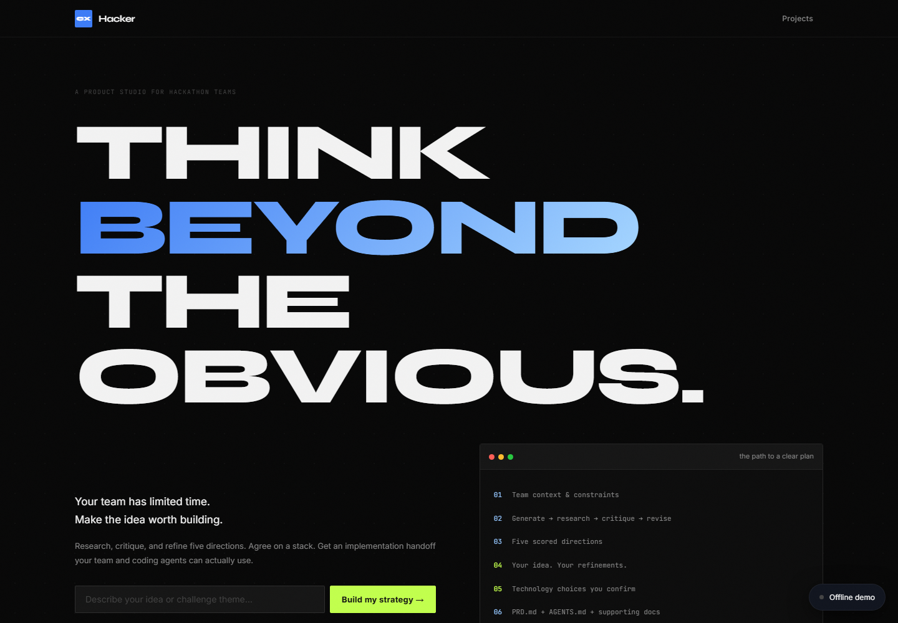
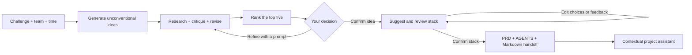
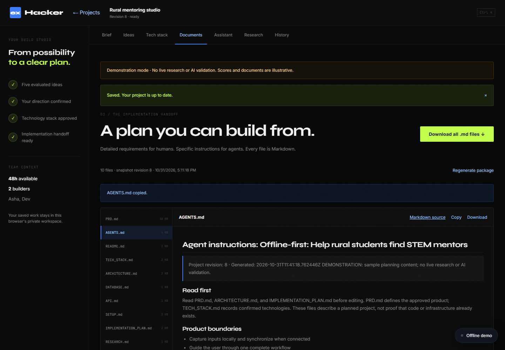
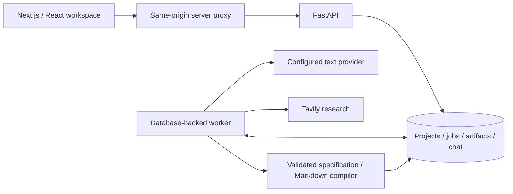

<div align="center">

# exHacker

### Think beyond the obvious. Build with a clear plan.

**A product studio for hackathon teams.**

Research five directions. Make the idea yours. Leave with a handoff your team can build.

[](LICENSE)
[](frontend/package.json)
[](frontend/package.json)
[](backend/pyproject.toml)
[](backend/app/main.py)

[**Try it locally**](#try-it-in-one-command) · [**Explore the workflow**](#from-a-challenge-to-a-build-plan) · [**Read the docs**](#the-developer-desk)



</div>

> [!NOTE]
> **Active development, with reproducible verification.** Real Docker, PostgreSQL, browser, export, and recovery checks are recorded in [verification evidence](docs/VERIFICATION.md). Hosted deployment and live-provider quality still need release validation. There is no hosted demo to advertise yet.

## The clock starts before the code

*What should we build? Does it already exist? Can this team finish it?* Those questions can consume the best hours of a hackathon. exHacker gives them a working process: start with the people and constraints, challenge the ideas with evidence, then turn the chosen direction into a detailed build plan.

<table>
<tr>
<td width="50%">

### Explore with evidence

Five distinct directions, competitor sources, visible critiques, risks, effort estimates, and eight explained scores.

</td>
<td width="50%">

### Keep control of the idea

Refine with your own prompt. Compare alternatives. Confirm the direction and technology choices yourself.

</td>
</tr>
<tr>
<td>

### Hand off something useful

A detailed `PRD.md`, dedicated `AGENTS.md`, and eight supporting Markdown files. Preview, copy, or download them.

</td>
<td>

### Keep the team moving

A persistent assistant with the plan, research, documents, team skills, hackathon, and conversation context.

</td>
</tr>
</table>

## From a challenge to a build plan



| You bring | exHacker develops | You approve |
| --- | --- | --- |
| A challenge, team skills, available time, and optional rules/budget | Researched directions with critique and scoring | The idea worth pursuing |
| Preferences and technology substitutions | Components, data flow, trade-offs, and compatibility review | The stack your team will use |
| The confirmed plan | Requirements, acceptance criteria, contracts, named tasks, and agent instructions | A handoff to review and build from |

> [!IMPORTANT]
> Scores are advisory estimates. Search results cannot prove uniqueness or guarantee a winning entry. Evidence and reasoning stay visible so the team can make its own decision.

## A handoff you can work from



*Captured from the running application. This example uses explicitly labeled offline fixtures; it does not establish live research or model quality.*

| Product definition | Technical decisions | Build execution |
| --- | --- | --- |
| `PRD.md` | `TECH_STACK.md` | `AGENTS.md` |
| `RESEARCH.md` | `ARCHITECTURE.md` | `IMPLEMENTATION_PLAN.md` |
| `README.md` | `DATABASE.md` · `API.md` | `SETUP.md` |

**Rendered preview · Markdown source · Copy · Individual downloads · Reproducible ZIP**

> [!TIP]
> Documents come from one approved snapshot. Reading them never regenerates them. Changing an upstream decision invalidates affected approvals and documents while keeping earlier snapshots in History.

## Try it in one command

From a checkout, with Docker Compose v2 running:

```sh
docker compose -p exhacker-verify -f compose.verify.yml up --build --wait
```

**Open [localhost:3200](http://localhost:3200).** No `.env` or API key is needed for this explicit offline evaluation.

| Runs for real | Uses offline fixtures |
| --- | --- |
| Frontend, API, PostgreSQL, migrations, jobs, exports, persistence | Idea content, scores, documentation, and demonstration assistant |

<details>
<summary><strong>Your first five-minute walkthrough</strong></summary>

1. Enter a 48-hour mentoring challenge and add a React builder and a Python builder.
2. Compare the five directions and refine one with your own prompt.
3. Confirm it, edit a technology choice, and approve the stack.
4. Preview `PRD.md` and `AGENTS.md`, copy a file, and download the package.
5. Open the assistant and reload the page to see saved conversation history.

Offline mode has no live research. Natural-language stack revisions require live AI; manual edits work in the demonstration.

Stop without deleting the evaluation database:

```sh
docker compose -p exhacker-verify -f compose.verify.yml down
```

</details>

<details>
<summary><strong>Run with live AI and web research</strong></summary>

Copy `.env.example` to `.env` at the repository root. Use `cp .env.example .env` on macOS/Linux or `Copy-Item .env.example .env` in PowerShell. Configure a suitable provider-qualified text model, its API key, verified pricing, and Tavily:

```dotenv
AI_MODEL=openai/gpt-4o-mini
AI_API_KEY=your-provider-api-key
TAVILY_API_KEY=your-search-api-key
STUDIO_DEMO_MODE=false
```

```sh
docker compose up --build --wait
```

Open [localhost:3000](http://localhost:3000). This development stack persists SQLite in its own volume. Missing providers produce visible errors and preserve saved work. Model account access and quality need validation. User BYOK is being implemented under the approved [credential design](docs/BYOK.md).

</details>

<details>
<summary><strong>Develop without Docker</strong></summary>

Use Python 3.12 (minimum 3.11), [uv](https://docs.astral.sh/uv/), and Node.js 22+. Configure the root `.env`, then start two terminals:

```sh
# Terminal 1
cd backend
uv sync --frozen --extra dev
uv run uvicorn app.main:app --reload
```

```sh
# Terminal 2
cd frontend
npm ci
npm run dev
```

The frontend proxy defaults to `http://127.0.0.1:8000`. Set server-side `BACKEND_URL` in the frontend process or `frontend/.env.local` to change it. Python's root `.env` is not automatically a Next.js environment file.

</details>

## Decisions survive the page



| Interface | Application | Reliability |
| --- | --- | --- |
| Next.js 16.4 · React 19 · TypeScript | FastAPI · Pydantic · SQLAlchemy · Alembic | Durable jobs · optimistic revisions · explicit approval gates |
| Responsive black/blue/lime workspace | SQLite locally · PostgreSQL verified in Docker | Atomic publication · leases · bounded recovery |

Failed jobs retain the previous successful context. Stale tabs cannot overwrite newer revisions. Recovery can repeat paid provider work; external billing is not exactly once. The [architecture guide](docs/ARCHITECTURE.md) describes the actual guarantees.

## The developer desk

| Start here | Go deeper |
| --- | --- |
| [Configuration and environment variables](docs/CONFIGURATION.md) | [Architecture and directory map](docs/ARCHITECTURE.md) |
| [Testing and browser workflows](docs/TESTING.md) | [Observed verification results](docs/VERIFICATION.md) |
| [Deployment and operations](docs/DEPLOYMENT.md) | [Security and privacy](SECURITY.md) |
| [Contributing](CONTRIBUTING.md) | [Approved BYOK architecture](docs/BYOK.md) |

<details>
<summary><strong>Run the checks</strong></summary>

```sh
cd backend
uv run ruff check app tests migrations ../scripts
uv run pytest -q
cd ../frontend
npm run lint
npm run typecheck
npm run build
npx playwright install chromium
npm test
```

With the verification stack already running, check PostgreSQL and actual process recovery from the repository root:

```sh
docker compose -p exhacker-verify -f compose.verify.yml run --rm --build backend-tests
python scripts/verify_docker.py --restart
```

See [testing](docs/TESTING.md) for container browser targeting, screenshots, isolation, and CI.

</details>

> [!WARNING]
> **Review the release gates before public hosting.** The backend needs a persistent process, PostgreSQL, HTTPS, backups, and abuse controls. Live-provider evaluation and the [upstream dependency advisory review](docs/VERIFICATION.md#remaining-python-advisory-constraint) remain open. The default Compose file is a local SQLite setup.

> [!CAUTION]
> **Save your workspace key privately.** Anyone holding it can access the workspace; losing it loses access. Project text and chat persist and may be sent to the configured AI/search providers. Never paste credentials into those fields. Read [SECURITY.md](SECURITY.md) before using sensitive data.

<div align="center">

**Built for teams who want to spend their hackathon building.**

Created by [Muneer Alam](https://github.com/Muneer320) · [MIT license](LICENSE) · [Contributions welcome](CONTRIBUTING.md)

</div>
