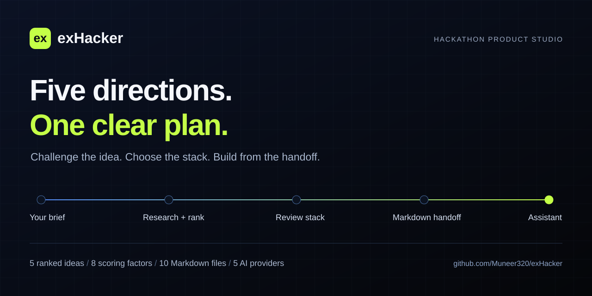
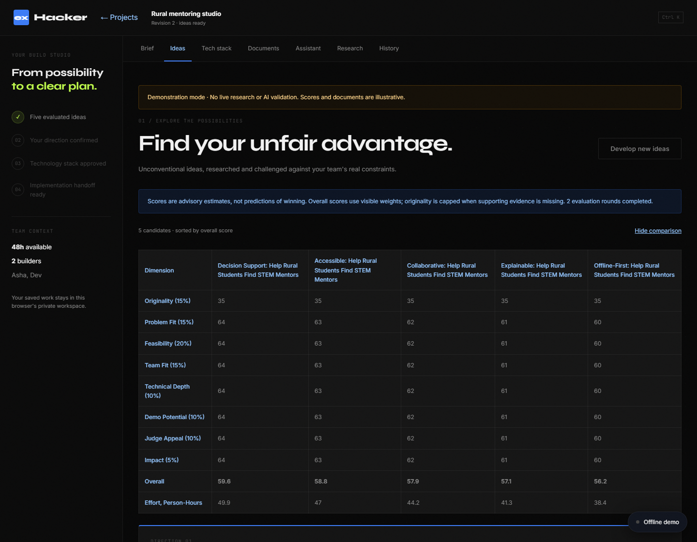
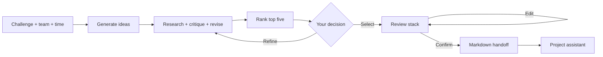
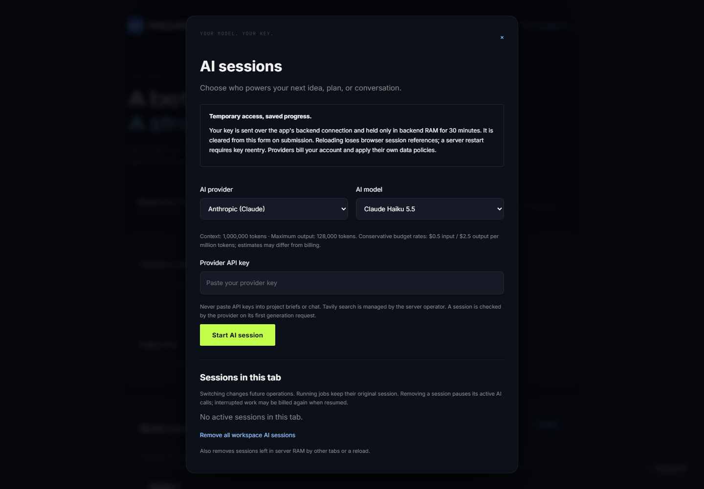
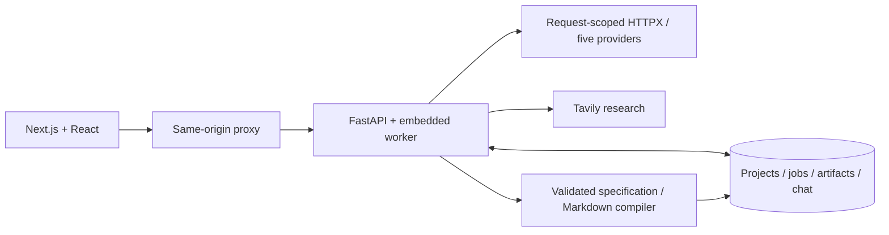

<div align="center">



**A product studio for hackathon teams.**

Research the possibilities. Make the decisions. Leave with a plan your team can build.

[](https://github.com/Muneer320/exHacker/actions/workflows/ci.yml)
[](LICENSE)
[](frontend/package.json)
[](backend/pyproject.toml)
[](backend/app/main.py)

[**Try locally**](#try-it-locally) · [**The workflow**](#from-brief-to-build-plan) · [**Developer guides**](#the-developer-desk)

| 5 ranked directions | 8 explained scores | 10 Markdown files | 5 AI providers |
| :---: | :---: | :---: | :---: |
| Compare before committing | See reasoning and trade-offs | PRD, AGENTS, and a build handoff | Bring your own key |

</div>

## From brief to build plan



*Real application captures use explicitly labeled offline fixtures. They demonstrate the workflow, not live model or research quality.*



| Explore with evidence | Keep creative control | Build from a shared plan |
| --- | --- | --- |
| Competitors, source links, critiques, risks, effort estimates | Refine ideas with a prompt; edit and approve the stack | Human-readable requirements and dedicated agent instructions |
| Team skills, deadline, budget, and judging criteria shape the result | Decisions stay with the team at each approval gate | Persistent assistant uses the plan, research, team, and chat |

> [!IMPORTANT]
> Scores are advisory estimates. Search cannot prove uniqueness or guarantee a winning entry. Evidence and reasoning stay visible for your review.

## Your next commit starts here


| Product definition | Technical decisions | Build execution |
| --- | --- | --- |
| `PRD.md` | `TECH_STACK.md` | `AGENTS.md` |
| `RESEARCH.md` | `ARCHITECTURE.md` | `IMPLEMENTATION_PLAN.md` |
| `README.md` | `DATABASE.md` · `API.md` | `SETUP.md` |

**Preview · Markdown source · Copy · Individual downloads · Reproducible ZIP**

> [!TIP]
> Documents come from one approved snapshot. Reading never regenerates them. Upstream changes invalidate affected approvals and documents; earlier snapshots remain in History.

## Try it locally

Clone the repository, then start the explicit offline evaluation with Docker Compose v2:

```sh
git clone https://github.com/Muneer320/exHacker.git
cd exHacker
docker compose -p exhacker-verify -f compose.verify.yml up --build --wait
```

**Open [localhost:3200](http://localhost:3200). No `.env` or API keys needed.**

| Runs for real | Uses offline fixtures |
| --- | --- |
| Frontend, API, PostgreSQL, migrations, jobs, persistence, exports | Idea content, scores, documents, demonstration assistant |

<details>
<summary><strong>A five-minute walkthrough</strong></summary>

1. Enter a challenge, deadline, and teammates with their skills.
2. Compare five directions and refine one with your own prompt.
3. Select it, edit a technology choice, and confirm the stack.
4. Preview `PRD.md` and `AGENTS.md`; copy or download the handoff.
5. Ask the assistant how to split the work. Reload to see saved history.

Natural-language stack revisions need live AI; manual edits work offline. Stop while retaining evaluation data:

```sh
docker compose -p exhacker-verify -f compose.verify.yml down
```

</details>

<details>
<summary><strong>Connect live AI and web research</strong></summary>

Copy the root `.env.example` to `.env`: `cp .env.example .env` on macOS/Linux or `Copy-Item .env.example .env` in PowerShell. Configure your Tavily key for search:

```dotenv
AI_ACCESS_MODE=byok
AI_LEASE_SECONDS=1800
TAVILY_API_KEY=your-search-api-key
STUDIO_DEMO_MODE=false
```

```sh
docker compose up --build --wait
```

Open [localhost:3000](http://localhost:3000), click **Connect AI**, and enter your provider key in the dedicated form. This development stack persists SQLite in its own volume. The separate app on port **3200** always uses verification fixtures.

Use the [API-key testing walkthrough](docs/TESTING.md#live-testing-with-your-api-keys) to check the full workflow, switching, expiry, and recovery. Missing credentials produce visible errors and preserve saved work.

</details>

<details>
<summary><strong>Develop without Docker</strong></summary>

Use Python 3.12 (minimum 3.11), [uv](https://docs.astral.sh/uv/), and Node.js 22+. Configure the root `.env`, then start two terminals:

```sh
# Terminal 1
cd backend
uv sync --frozen --extra dev
uv run uvicorn app.main:app --reload
```

```sh
# Terminal 2
cd frontend
npm ci
npm run dev
```

The frontend proxy defaults to `http://127.0.0.1:8000`. Override server-side `BACKEND_URL` in the frontend process or `frontend/.env.local`. The root `.env` is not automatically a Next.js environment file. See [configuration](docs/CONFIGURATION.md).

</details>

## Your choice of intelligence

| OpenAI | Anthropic | Google | xAI | Groq |
| --- | --- | --- | --- | --- |
| GPT-6 Luna | Claude Haiku 5.5 | Gemini 3.8 Flash | Grok 4.7 | GPT OSS 120B / 20B |

**Choose a model → Connect a temporary key → Switch future operations → Keep your artifacts**

<details>
<summary><strong>See the temporary AI session controls</strong></summary>



*Real interface; no entered API key. This capture does not establish paid-provider access.*

</details>

> [!NOTE]
> AI keys live in backend RAM under a default 30-minute lease. Expiry, removal, or restart pauses affected jobs for reentry. Reloading clears this tab's lease references; saved projects remain. Tavily stays operator-managed. Account quotas can be smaller than model context limits. [BYOK design and limitations](docs/BYOK.md).

## Under the workspace



| Interface | Application | Recovery |
| --- | --- | --- |
| Next.js 16.4 · React 19 · TypeScript | FastAPI · Pydantic · SQLAlchemy · Alembic | Durable jobs · revision checks · approval gates |
| Responsive black, blue, and lime workspace | SQLite locally · PostgreSQL verified in Docker | Atomic publication · leases · saved research checkpoints |

<details>
<summary><strong>What survives a failure?</strong></summary>

Failed operations retain the previous successful context. Stale tabs cannot overwrite newer revisions. Saved candidate/research checkpoints let unchanged idea jobs resume within their reuse window. AI leases never enter the database; restarts require credential reentry. Recovery can repeat paid work; external billing is not exactly once. See the [architecture](docs/ARCHITECTURE.md).

</details>

## The developer desk

| Run and contribute | Understand and operate |
| --- | --- |
| [Configuration and environment variables](docs/CONFIGURATION.md) | [Architecture and directory map](docs/ARCHITECTURE.md) |
| [Tests, browser checks, and live-key walkthrough](docs/TESTING.md) | [BYOK sessions and recovery](docs/BYOK.md) |
| [Contributing](CONTRIBUTING.md) | [Deployment and operations](docs/DEPLOYMENT.md) |
| [MIT license](LICENSE) | [Security and privacy](SECURITY.md) |

> [!WARNING]
> **Active development; public-hosting validation remains open.** BYOK needs one persistent API process with its embedded worker. Review HTTPS, PostgreSQL, backups, abuse controls, live-provider quality, dependency advisories, and load testing before hosting. Start with the [deployment guide](docs/DEPLOYMENT.md).

> [!CAUTION]
> **Save your workspace key privately.** Anyone holding it can access the workspace; losing it loses access. Project text and chat persist and may be sent to selected providers. Enter credentials only in the dedicated AI session form. [Security boundaries](SECURITY.md).

<div align="center">

Created by [Muneer Alam](https://github.com/Muneer320) · [MIT license](LICENSE) · [Contributions welcome](CONTRIBUTING.md)

</div>
