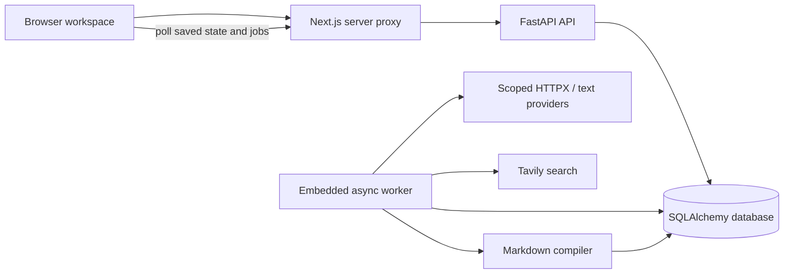
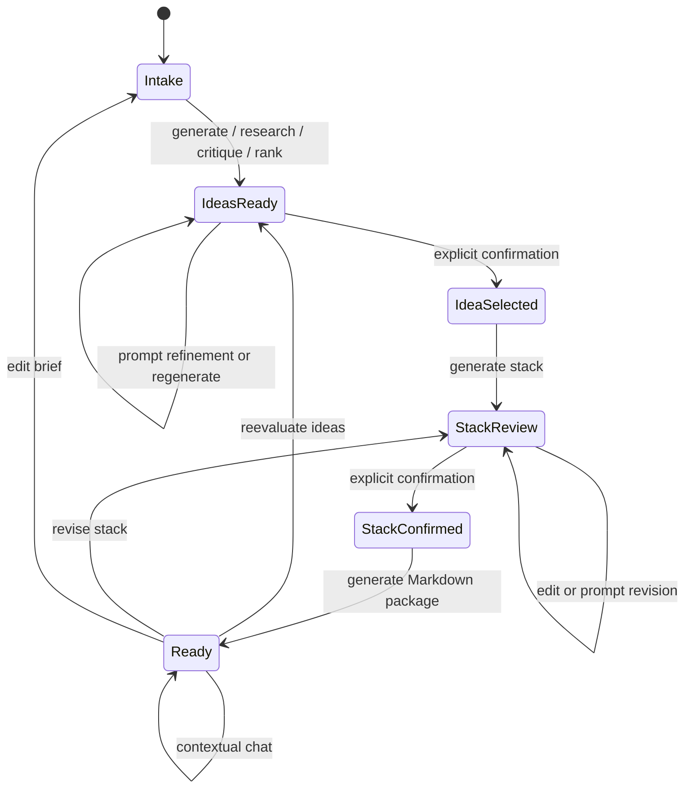

# Architecture

[Back to the project](../README.md)

exHacker turns an early challenge into an approved, versioned build plan. Its unit of consistency is one project revision: intake, evaluated ideas, selected idea, stack approval, research, and documents must agree before the assistant uses them.



## Runtime boundaries

The browser creates a random workspace bearer key with Web Crypto and stores that workspace token locally. The API stores its SHA-256 hash as the owner scope. Provider keys use a separate dedicated form and credential endpoint. The password field clears on submission; only opaque expiring lease metadata remains in browser memory. The Next.js proxy forwards bounded JSON, workspace authorization and a separate `X-AI-Lease` routing header.

The API validates ownership/revisions and captures immutable provider/model/source metadata with an opaque RAM-lease reference outside the job payload. Its single embedded worker resolves credentials from the same process immediately before each AI call. Closing a browser does not cancel an accepted job while its lease is valid. Expiry, removal, rejected credentials or restart pauses a job as `credentials_required`; matching reentry resumes from saved inputs. Prior artifacts remain readable. Explicit operator mode never acts as a fallback for BYOK jobs.

The backend is a persistent process. A request-only serverless function cannot host this embedded worker reliably. The frontend can run independently as a standalone Node server or on a compatible Next.js host.

## Workflow and approvals



Changing the brief clears the current derived context. Reevaluating ideas clears selection, stack, and documents. Stack changes clear its approval and documents. Historical artifacts remain inspectable. Chats retain their originating context revision; future answers receive the latest confirmed context and the complete saved conversation.

Idea and stack confirmations, their audit artifacts, and their follow-up jobs commit in one transaction. A queue failure rolls the approval back. A job uses an atomic compare-and-set against the current revision and active job, so stale tabs or overlapping operations cannot silently overwrite newer work.

## Generative pipeline

1. Validate team constraints and derive person-hour capacity.
2. Generate distinct initial candidates or a refinement of one selected candidate.
3. Search for competitors and similar projects for each candidate.
4. Critique assumptions, evidence, scope, team fit, and demo potential; revise and rescore.
5. Repeat for the configured 1–3 rounds and retain five ranked ideas.

The critique/revision pass is a separate model call with a reviewer/designer prompt, not a fleet of autonomous agents or hidden proof of quality. Critique and changes are visible artifacts. Source references must match retrieved IDs; lack of evidence caps originality, and over-capacity effort caps feasibility. Overall scores are calculated from eight explicit weights. The result remains advisory and cannot prove market uniqueness or competition success.

Stack generation uses the exact confirmed idea. Manual technology substitutions must survive provider review unchanged in their category or the operation fails. Detailed specifications are schema-validated, checked for task dependency cycles, real teammate owners, capacity, critical path, and a concrete schedule. One planning repair attempt is permitted. The Markdown compiler builds ten consistent files from that saved specification and confirmed snapshot.

## Persistence

| Table | Holds |
| --- | --- |
| `studio_projects` | Owner hash, intake, current context/revision, active job, usage counters. |
| `studio_jobs` | Operation input/revision, provider/model/source and opaque reference, status, worker lease, attempts, events, safe error message. Never an API key. |
| `studio_artifacts` | Historical snapshots, idea-round audit records, research cache. |
| `studio_messages` | User/assistant messages and their context revisions. |

All child tables reference the project with delete cascade. Prototype tables are left untouched. There is no automatic owner assignment or migration of old prototype records into private workspaces.

GET requests do not generate new documents. Exports use saved Markdown, content hashes, and fixed ZIP entry timestamps, so repeated exports of a saved document revision match byte for byte. A chat turn increments the project revision without rewriting the earlier document package.

## Worker reliability and limits

Workers atomically claim queued or expired jobs, increment attempts, and renew leases with a heartbeat. Completion publishes the project result, job status, snapshot, and any chat messages in one transaction. Superseded attempts cannot publish. Failure preserves the previous successful project context and records a safe error for retry.

On graceful shutdown an owned running job returns to the queue. Following an abrupt process death, its lease eventually expires. Idea generation saves its initial candidates, completed research, and each reviewed round. Retry/recovery reuses the last validated checkpoint for the same project/input revision within 24 hours, even when the user chooses another provider for the retry. Changed inputs, a different project, or expired progress start a fresh operation. Checkpoint writes are fenced against superseded worker attempts. Other operations restart from saved input. An interrupted external call can still repeat and incur charges. After three interrupted attempts, the job fails for manual review rather than retrying forever.

BYOK requires one API process and its embedded worker because the credential registry is process-local. Separate workers and multiple replicas are unsupported. Database claiming alone does not distribute RAM credentials. Production load, fairness, throughput and failure timing need deployment-specific validation. This is not an exactly-once paid-inference system.

## Important code

```text
backend/app/
  main.py                 API lifecycle, readiness, safe HTTP errors
  core/                   Settings, logging, request-size middleware
  db/session.py           Engine and request/worker session lifecycle
  studio/
    schemas.py            Input and generated artifact contracts
    models.py             Four additive studio tables
    routes.py             Ownership, revisions, approvals, downloads
    jobs.py               Queue, leases, recovery, atomic publication
    credentials.py        Owner-bound RAM leases and active-call cancellation
    credential_routes.py  Dedicated nonpersistent key endpoint
    inference.py          Captured routing and per-call credential checks
    providers.py          Finite model catalog and budget-rate snapshot
    transport.py          Five request-scoped native HTTPX adapters
    ai.py                 Schema validation and spend reservation
    research.py           Tavily requests, source filtering and caching
    pipeline.py           Idea, stack, documentation, and chat workflows
    documents.py          Deterministic Markdown compiler
    demo.py               Explicit offline fixtures
frontend/src/
  app/api/v1/[...path]/    Same-origin bounded server proxy
  app/projects/           Intake, workspace, and route entry points
  components/studio/      Forms, stage panels, polling, notifications
  components/markdown/    Untrusted Markdown rendering
  services/api.ts         Typed requests and workspace access
```

See [security](../SECURITY.md), [deployment](DEPLOYMENT.md), and the implemented [BYOK lifecycle](BYOK.md) for the boundaries of this design.
