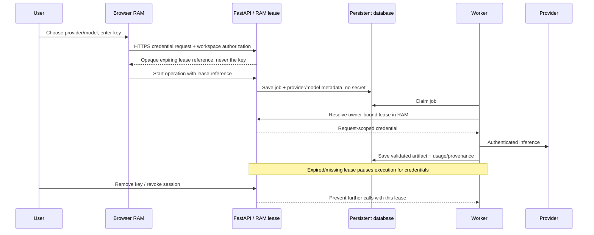

# Bring Your Own Key: feasibility and proposed architecture

**Status: proposal only, awaiting explicit approval. No BYOK runtime functionality has been implemented.**

Assessed against the current repository and official provider documentation on 2026-10-31. Adapter compatibility is established by documentation and local code inspection; successful paid calls with all five providers have **not** been demonstrated.

## Decision in one paragraph

All five requested providers can fit the existing text-generation workflow through LiteLLM. We can design for **no intentional application persistence of users' API keys**. We cannot honestly promise **browser-only credentials**, **background execution after the browser closes**, and **automatic recovery after all server memory is lost** simultaneously. My recommendation is an explicit, short-lived credential lease in backend RAM, with keys entered and retained only in browser memory on the client. Workers can finish while the lease remains valid; expiry or a backend restart requires the user to supply credentials again. The backend necessarily sees the key in transit and memory. If the backend must never receive it, use browser orchestration and accept a larger rewrite and loss of unattended execution.

## What exists today

```text
Browser (workspace key, project inputs)
  -> Next.js proxy
  -> FastAPI: persist job, return response
  -> worker: load persisted job
  -> ai.completion(): read operator settings, reserve cost, call LiteLLM
  -> research.search(): read operator Tavily key
  -> persist validated artifacts and safe job outcome
```

`backend/app/studio/ai.py` is the central inference boundary. All idea, critique, stack, specification, and chat calls go through it. `jobs.py` persists job input and processes it independently of the HTTP request. No provider key belongs in that payload: payloads are also copied into historical artifacts. The intake draft is saved to localStorage, so a key must never become another intake field. The existing workspace access key is a different credential with a different persistence policy.

The current application uses ordinary text messages plus server-side JSON validation. It does not depend on provider-specific agent SDKs, tool calling, native search, or hosted conversation state. This makes the core workflow portable. Its significant requirements are output quality, nested schema compliance, context size, output-token allowance, usage reporting, latency, and cost.

## Provider feasibility

| Provider | LiteLLM prefix | Assessment and relevant limitations |
| --- | --- | --- |
| OpenAI | `openai/` | Suitable text models can generate artifacts and chat. Output/context limits and parameter support vary by model. OpenAI advises keeping API keys out of client-side code. [API authentication](https://developers.openai.com/api/reference/overview), [structured outputs](https://developers.openai.com/api/docs/guides/structured-outputs). |
| Anthropic / Claude | `anthropic/` | LiteLLM adapts messages to Anthropic's interface. Evaluate the chosen model's output budget and schema support. Its browser SDK is disabled by default and requires an explicit dangerous-browser opt-in. [LiteLLM adapter](https://docs.litellm.ai/docs/providers/anthropic), [official TypeScript SDK](https://platform.claude.com/docs/en/cli-sdks-libraries/sdks/typescript). |
| Google / Gemini | `gemini/` | Use Gemini API / AI Studio keys for this path; Vertex AI authentication is a separate integration. Google's production guidance recommends backend proxying. Gemini's documented ephemeral tokens are for the Live API, not a universal credential replacement for this text pipeline. [Key guidance](https://ai.google.dev/gemini-api/docs/api-key), [ephemeral tokens](https://ai.google.dev/gemini-api/docs/live-api/ephemeral-tokens). |
| xAI / Grok | `xai/` | A LiteLLM text adapter exists. Verify support for the selected model and API surface rather than assuming every Grok feature works through chat completions. xAI now documents Responses as its preferred surface; adopting it would require checking storage defaults and adapter behavior. [Adapter](https://docs.litellm.ai/docs/providers/xai), [official text API](https://docs.x.ai/developers/model-capabilities/text/generate-text). |
| Groq | `groq/` | Text models fit the common interface, but an OpenAI-compatible API is not feature-identical. Strict structured output is limited to supported models, and some OpenAI parameters are rejected. Smaller model context/output limits may rule out a full document handoff. [Compatibility](https://console.groq.com/docs/openai), [structured output restrictions](https://console.groq.com/docs/structured-outputs), [adapter](https://docs.litellm.ai/docs/providers/groq). |

The [LiteLLM provider catalog](https://docs.litellm.ai/docs/providers) lists all five. No new orchestration framework is needed. This means **provider support is feasible**, not that **every model from each provider can satisfy every stage**. A release should expose an evaluated model list with capability metadata; unknown model names should require explicit advanced handling rather than a promise of compatibility.

## Options

| Approach | Where the key exists | Background behavior | Main trade-off |
| --- | --- | --- | --- |
| Browser calls providers directly | Browser RAM and provider | Browser must remain active; reload loses the key and active execution | Strictest application-server separation, but loses the existing Python adapter and server orchestration. Provider CORS/SDK behavior must be tested individually. Client-generated scores, provenance, and accounting cannot be treated as server-verified. |
| Browser-driven calls through a stateless relay | Browser RAM and backend RAM during each request | Browser drives each stage and retry | Keeps provider adaptation server-side and avoids a server-side session secret pool, but requires splitting/reworking the durable workflow. Background completion cannot be promised. |
| **Short-lived backend RAM lease — recommended** | Browser RAM, backend RAM, provider | Jobs run for a bounded lease lifetime; server restart requires credentials again | Preserves the current worker architecture with no application secret database. Single-process ownership is important; keys are not browser-only. |
| Encrypted durable secret storage | Browser, server secret storage, provider | Can survive reloads and server restarts unattended | Closest to today's durability, but intentionally stores credentials and conflicts with the requested preference. Encryption at rest is still storage. |

Short-lived provider tokens do not currently supply a documented, universal substitute for ordinary text API keys across these five integrations. Live/Realtime tokens cannot be assumed to authenticate this pipeline's normal completion requests. This assessment does not claim that direct browser HTTP calls are universally blocked; CORS and API support require provider-by-provider testing, and working transport would not remove browser security risks.

## Recommended credential flow



1. A dedicated password-style field stores the key in React memory, separate from intake, project state, drafts, URL parameters, localStorage, sessionStorage, IndexedDB, cookies, and analytics. Route changes may preserve it within the active app session; page reload requires reentry. Browser password managers/extensions remain outside our control.
2. Send it over HTTPS through a dedicated credential boundary. The Next.js proxy, reverse proxy, FastAPI, SDK, and any monitoring tools must avoid body/header capture. Never put it in query strings, model prompts, error strings, logs, or environment variables.
3. Store a bounded, owner-bound lease in a small in-process secret registry. A proposed starting policy is a 30-minute absolute lifetime with an explicit user extension, not indefinite automatic retention. The UI shows whether a key is loaded and when the server lease expires.
4. Jobs persist only non-secret references and immutable provider/model/capability/rate metadata. Worker calls receive an explicit credential object, never process-global settings modified per user. No cross-user default fallback is allowed.
5. Expired or absent credentials cause a visible `credentials_required` condition and a resume action. They must not trigger repeated inference attempts, silent owner-key use, or disclosure of the key into a retry payload.
6. Explicit removal clears browser state and revokes the backend lease. Queued/future calls stop. In-flight provider requests may already be accepted or billed; revocation cannot undo them. A disconnected browser cannot deliver a revoke request, so the disclosed expiry policy still applies.
7. Start with the current single persistent backend process. Multiple replicas would need credential-affine dispatch or a deliberately designed shared volatile secret service. Ordinary Redis can write snapshots/AOF or be backed up; it must not be casually described as nonpersistent. Adding it is a separate deployment decision, not required for the first version.

## Recovery and provider switching

The current worker reruns interrupted operations from saved inputs. RAM-only credentials add a new recovery gate: a restarted worker has the job and project, but no secret. It must wait until the workspace owner supplies the matching provider credentials and approves resuming potentially billable work. Existing valid artifacts remain readable and downloadable without an AI key.

Changing provider/model is supported **between jobs**, not by mutating an in-flight operation. Prior approved artifacts remain versioned; future output records its provider/model provenance. A user can choose to regenerate artifacts with the new model, which follows the normal approval/invalidation rules. Changing providers does not silently reinterpret an already-approved plan.

Models need a capability check for the full stage's input and output, plus consistent error mapping for authorization, model access, quotas, truncation, refusals, and schema failures. Server-side validation remains authoritative even when a provider offers native structured output. Pricing and reservation metadata must be captured per job/model rather than reusing one global price pair across all users.

## Research is a separate product decision

An OpenAI, Anthropic, Gemini, xAI, or Groq key does **not** authenticate Tavily. The existing evidence pipeline needs its own search credential. Provider-native search is not a drop-in replacement: availability, result structure, citations, and costs differ, and we currently validate our own retrieved source IDs.

For an initial BYOK AI release, keep operator-managed Tavily behind strict query/abuse limits and clearly disclose that split. If avoiding every owner-funded service is required, add an optional user-supplied Tavily key under the same approved lease policy in a subsequent explicit scope. Do not pretend AI BYOK alone makes the whole product provider-cost-free.

## Realistic security guarantees

We can design and test that **the dedicated key field is not intentionally persisted or logged by application code**, that no key appears in normal database records/exports/job payloads, and that owner-bound lease removal/expiry prevents subsequent use. Sentinel-key tests should inspect database rows, history, exports, captured logs, error responses, local browser storage, and client bundles after success, invalid-key errors, timeouts, retries, and restarts.

We cannot promise that a key never exists outside browser memory under the recommended design. TLS termination, the proxy, backend process, and provider see it. Python/JavaScript strings cannot offer reliable physical zeroization. Swap/pagefiles, core dumps, host memory snapshots, SDK tracing, session replay, reverse-proxy capture, and a compromised operator/browser can violate the intended boundary unless infrastructure and dependencies are configured accordingly. Provider processing and retention policies remain their own responsibility. Users may also paste secrets into ordinary project text or chat; those fields are persisted, so the UI must explicitly discourage that.

Public hosting should add a reviewed CSP, strict destination allowlists, dependency controls, rate/concurrency limits, encrypted transport, operational logging policy, and secret-leak regression tests before accepting user keys. A BYOK endpoint must not accept arbitrary provider base URLs: that would create credential-exfiltration and server-request-forgery risks. These controls reduce risk; they do not constitute a security certification.

## Approval needed

The recommended scope is **five-provider AI BYOK through an explicit, expiring backend RAM lease**, retaining operator-managed Tavily for research initially. The key consequence to approve is that users must reenter credentials after a page reload, lease expiry, or backend restart; uninterrupted recovery through loss of all volatile memory is intentionally unavailable. If the non-negotiable requirement is that our backend never receives the key, choose browser orchestration instead and accept its workflow limitations.

No credential form, lease endpoint, secret registry, BYOK database change, or worker credential behavior has been added as part of this assessment.
