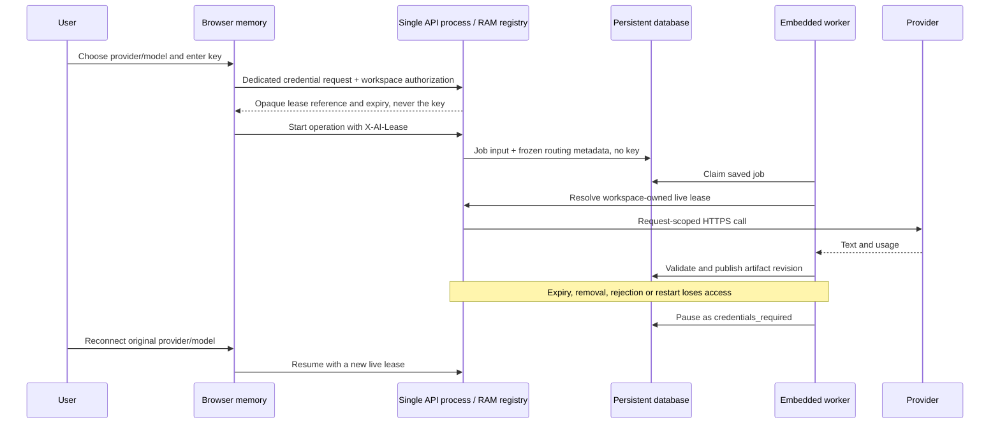

# Bring Your Own Key

[Back to the project](../README.md)

> [!IMPORTANT]
> Implemented: expiring, owner-bound backend RAM leases for OpenAI, Anthropic, Gemini, xAI, and Groq. Protocol and workflow tests use synthetic credentials and controlled external responses. Paid provider access and model quality have not been established by these tests.

## Connect and use a key

1. Open **Connect AI** from any screen. Select a supported provider and model.
2. Paste the provider's API key and choose **Start AI session**. The password field clears immediately. The provider verifies access on the first generation request, not at registration.
3. Generate ideas, refine, approve the stack, create documents, and use the assistant. New operations capture the selected session, provider, and model.
4. Use another active session to change future operations. Previously generated artifacts remain available. Running jobs retain their original session.
5. Extend explicitly, remove one session, or remove all workspace sessions. Removal cancels its active AI requests and pauses affected jobs. It does not revoke the key at the provider; do that through the provider if a key is compromised.

No API key is needed in explicit offline demonstration mode. Operator mode is a separate server configuration, never a fallback when BYOK credentials are missing.

## Lifecycle and recovery

The default lease lasts **30 minutes**, configurable from 60 seconds to one hour through `AI_LEASE_SECONDS`. Access uses monotonic deadlines. Cleanup runs every second and on lookups; expired entries are inaccessible immediately at their deadline. Explicit renewal extends a live lease, never revives an expired one. There are at most three live leases per workspace and 512 per process. Remove old sessions if a reload loses their browser references.

The browser keeps the raw key only in the transient password field/request until submission finishes. It retains only opaque lease metadata in React/module memory afterward. Provider credentials are not written to localStorage, sessionStorage, cookies, drafts, databases, job payloads, artifact snapshots, exported files, or application logs. The independent workspace access token intentionally persists locally so projects remain reachable.

A browser reload loses this tab's session references. Already accepted jobs may finish while their backend lease remains valid. Reconnect for future operations, or remove all workspace sessions to stop leases left by reloads/other tabs. Closing a tab does not immediately revoke its backend lease.

A backend restart loses the entire credential registry. Queued/reclaimed BYOK jobs pause before inference or research starts. A paused job retains its project lock and original provider/model. Its previous successful project context, documents, exports and conversation remain readable. Supply a fresh matching session and **Resume operation**, or cancel the paused/queued job to release the project. Cancellation does not delete artifacts. For a running job, remove its session and wait for it to pause before cancellation.

Attempt identities never reset, so stale workers cannot overwrite a resumed operation. Explicit resume separately resets its bounded interruption allowance. Idea operations resume validated candidate/research/round checkpoints for unchanged inputs within 24 hours. Other operations rerun from saved inputs. No operation continues inside a partially completed provider request. Repeated work can incur repeated charges. A key rejected with HTTP 401/403 is removed and the job requests credentials again. Other request/model/quota failures are safe visible errors; transient 429/5xx/network failures have one bounded retry. Short numeric Retry-After cooldowns are respected; waits over 60 seconds require a later explicit retry. Rejection errors expose only the provider label and numeric HTTP status, never the raw provider body.

## Deployment boundary

> [!WARNING]
> BYOK requires exactly **one persistent API process with its embedded worker**. Do not use multiple Uvicorn workers, separate worker processes, rolling replica overlap, or a multi-replica load balancer with this RAM-only design. Database job claiming is durable; credentials are deliberately process-local. A different process cannot resolve a lease.

The normal backend image starts one Uvicorn worker. Production requires Tavily; it requires an operator AI key only in explicit `AI_ACCESS_MODE=operator` mode. Run migrations before production startup. Development/staging apply them automatically, including the additive nullable job-routing column. Legacy jobs without routing metadata retain operator semantics; new BYOK jobs never acquire operator credentials implicitly.

Use HTTPS on every public client connection and protect private proxy/backend links. Disable credential-route request/response capture, authorization-header capture, session replay, SDK/HTTP debug logging, and body tracing at every proxy/APM layer. Restrict process access, core dumps, swap/hibernation and crash-report retention. Python strings, HTTP buffers, garbage collection, the operating system, browser extensions, and provider infrastructure cannot provide provable physical byte zeroization. This design guarantees no intentional application persistence, not that a trusted host can never inspect memory.

## Provider contracts

Reviewed against official documentation on **2026-10-31**. The supported list is deliberately finite; a model appearing in a provider's catalog does not automatically make it compatible or available to every account. Model quality, rate limits and generated specifications still need live acceptance evaluation.

| Provider | Exposed model | Endpoint and behavior | Limits / caveats |
| --- | --- | --- | --- |
| OpenAI | `gpt-6-luna` | Native Responses API; `store: false`, low reasoning effort. | Account access required. Long-context pricing is estimated conservatively. [Model](https://developers.openai.com/api/docs/models/gpt-6-luna), [API authentication](https://developers.openai.com/api/reference/overview). |
| Anthropic | `claude-haiku-5-5` | Native Messages API; bearer authentication; explicit API version `2026-10-21`. | System instructions are separated from turns; no beta tools or adaptive-thinking assumptions. Higher long-context rates used for budgeting. [Messages](https://platform.claude.com/docs/en/api/messages/create), [pricing](https://platform.claude.com/docs/en/about-claude/pricing). |
| Google | `gemini-3.8-flash` | Gemini API `generateContent`; API key in a header, never the URL. | AI Studio/Gemini keys only, not Vertex credentials. Thought blocks are excluded; thought token usage counts toward estimates. Introductory pricing ends 2026-12-31; review the catalog before then. [Model](https://ai.google.dev/gemini-api/docs/models/gemini-3.8-flash), [pricing](https://ai.google.dev/gemini-api/docs/pricing). |
| xAI | `grok-4.7` | Native Responses API with `store: false`; no legacy Chat Completions workaround. | No provider-hosted search or conversation continuation is used. [Text API](https://docs.x.ai/developers/model-capabilities/text/generate-text), [model](https://docs.x.ai/developers/models/grok-4.7). |
| Groq | `openai/gpt-oss-120b`, `openai/gpt-oss-20b` | OpenAI-compatible Chat Completions, model-native completion limit and low reasoning effort. | The slash is part of Groq's native model ID. The documented free-plan limit is 8K TPM, independently of the 131K model context window. Full research reviews, documents and chat may require higher account limits. Check the [current rate limits](https://console.groq.com/docs/rate-limits). No assumption of strict schema support. [Models](https://console.groq.com/docs/models), [compatibility](https://console.groq.com/docs/openai). |

All adapters use request-scoped HTTPX clients, fixed HTTPS endpoints, no environment-proxy inheritance and no redirects. Clients close after success, failure or cancellation. LiteLLM and its authenticated-client cache are removed. BYOK never uses `AI_BASE_URL`. Operator mode may use an administrator-controlled OpenAI Responses endpoint; arbitrary user endpoints and arbitrary BYOK models are rejected.

Responses are bounded to 2 MB. Only normalized text, token counts, and finish state reach orchestration. Provider error bodies/headers are not exposed. Missing text, malformed responses, truncation and schema failures fail safely rather than publishing partial artifacts. No provider native search, batch jobs, file uploads, or hosted agent/conversation state is involved. `store: false` does not override the provider's own retention, training or abuse-monitoring policies.

Catalog context/output bounds and conservative USD estimates are frozen into the job at enqueue time, alongside the provider/model and opaque lease reference. Artifacts retain only public provider/model/source metadata. Reference handles require the workspace bearer token and never appear in public job/artifact metadata. Costs are estimates, not a provider invoice or a guaranteed billing cap. Set provider-side spending limits; check current catalog pricing before release.

## Credential API

All endpoints below require workspace bearer authorization, use private/no-store responses, and accept keys only at the dedicated creation endpoint.

| Route | Purpose |
| --- | --- |
| `GET /api/v1/config` | Public mode, finite model catalog, limits; no secrets. |
| `POST /api/v1/ai/leases` | Body: `provider`, `model`, `key`; returns reference/provider/model/expiry only. |
| `GET /api/v1/ai/leases/{handle}` | Current workspace's live lease metadata. Missing/expired/wrong-owner references receive the same safe 428 response. |
| `POST /api/v1/ai/leases/{handle}/renew` | Explicitly extend a live lease. |
| `DELETE /api/v1/ai/leases/{handle}` | Remove one lease and cancel its active AI calls. |
| `DELETE /api/v1/ai/leases` | Remove all sessions belonging to the workspace, including references lost after reload. |
| Project mutations with `X-AI-Lease` | Capture the selected session separately from persistent request bodies. |
| `POST /api/v1/projects/{id}/jobs/{job}/resume` | Revision body plus matching fresh lease header; resumes `credentials_required` only. |
| `POST /api/v1/projects/{id}/jobs/{job}/cancel` | Revision body; cancel queued/paused operation, preserve saved work. |

Keys are wrapped in Pydantic `SecretStr`, excluded from object representations, and never hashed/fingerprinted for persistence. Credential validation errors use a constant message without echoed input or field names. Unexpected failures log only safe identifiers/types. Log formatters redact registered/operator keys and common key patterns as a secondary defense. Project inputs/generated text are blocked when they contain registered secrets or recognizable credential patterns; this is a defense against mistakes, not a general-purpose secret scanner. Do not paste secrets into ordinary project fields.

## Verification

Registry tests cover ownership, capacity, expiry, renewal, revocation, shutdown and in-flight cancellation. API/job tests cover wrong-owner access, malformed input, restart/expiry/revocation pauses, no operator fallback, matching-model resume, cancellation, immutable routing, and no credential in persisted rows or public responses. Wire tests exercise all five native protocols and safe failures. Full real pipeline tests run every provider adapter against synthetic external responses. Browser tests exercise key entry/clearing, provider switching, storage inspection, document persistence and paused-job recovery.

`python scripts/verify_byok_restart.py` uses the disposable PostgreSQL Docker stack and real SIGKILL/recreation to prove RAM loss and safe job recovery. It enables the worker only with an empty registry and tests resubmission with the worker disabled, so it sends no paid or invalid inference calls. [Testing instructions](TESTING.md) distinguish these checks from live model evaluation.
